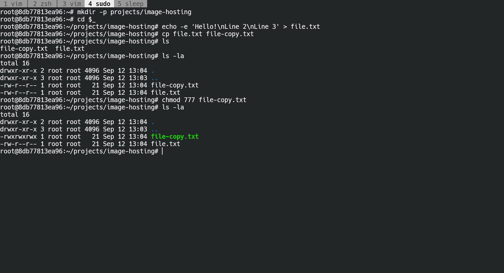
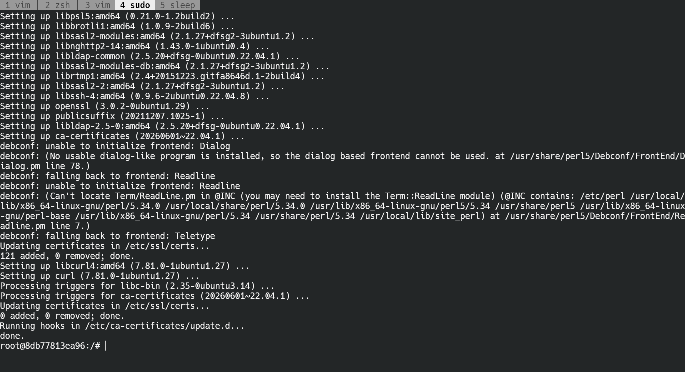

# Отчёт по Linux

## Список используемых команд

```
mkdir -p projects/image-hosting
cd $_
echo -e 'Hello!\nLine 2\nLine 3' > file.txt
cp file.txt file-copy.txt
ls
ls -la
chmod 777 file-copy.txt 
ls -la
apt update && apt install -y curl
```

## Скриншоты

1. Работа с файлами и директориями


2. Установка пакета `curl`

